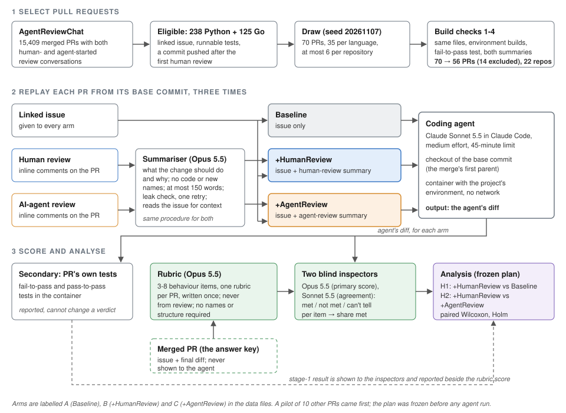
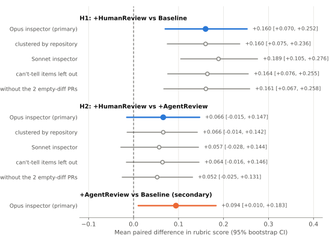
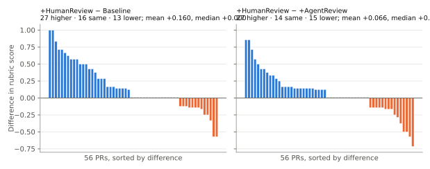
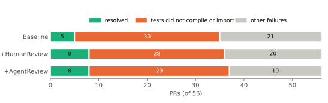
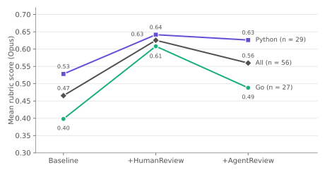

# Does human review intent help a coding agent? A three-arm replay on merged pull requests

Zili (Allen) Luo · Independent study, November 2026 · Not peer reviewed · Draft

## Abstract

Does human code-review intent, given to a coding agent before it writes anything, move its fix closer to what the project accepted? Merged pull requests (PRs) from AgentReviewChat are replayed three times from their base commit with Claude Sonnet 5.5 in Claude Code: with the linked issue only (Baseline), plus a summary of the human review (+HumanReview), or plus the same kind of summary of AI-agent review (+AgentReview). The primary outcome is a behaviour rubric written from the issue and the merged PR, never from review, and checked by two blind model inspectors; the PR's own fail-to-pass tests are secondary. On 56 PRs from 22 repositories (29 Python, 27 Go), mean rubric scores were 0.47 (Baseline), 0.63 (+HumanReview) and 0.56 (+AgentReview). +HumanReview beat Baseline by +0.16 (95% bootstrap CI +0.07 to +0.25; Holm-adjusted p = 0.003), a pre-registered significant difference that holds with a second inspector and repository-clustered intervals. The gain is uneven: 27 PRs scored higher, 16 the same and 13 lower; the median change is 0. +HumanReview against +AgentReview differed by +0.07 (CI -0.02 to +0.15; adjusted p = 0.15), and +AgentReview gained +0.09 over Baseline (secondary). Few runs passed the PR's own tests (5, 8 and 8 of 56): in 87 of 147 unresolved runs the tests did not compile or import. The median +HumanReview run used 51% more tokens than the median Baseline run.

> **Key findings**
>
> - On 56 merged PRs (22 repositories, Python and Go), giving the agent a 150-word summary of the human review before it started raised its rubric score from 0.47 to 0.63 (+0.16, 95% CI +0.07 to +0.25). The result holds with a second inspector and with repository-clustered intervals.
> - The gain is uneven: 27 PRs gained, 16 tied and 13 lost; the median change is zero.
> - Human-review intent was not shown to beat a summary of AI-agent review (+0.07, CI −0.02 to +0.15), and agent-review intent itself gained +0.09 over the issue alone. The study was sized to detect larger effects than this.
> - The PRs' own tests rarely pass (5-8 of 56 per arm). In most failures (87 of 147) the tests do not compile or import, because they call internal names only the merged PR introduced, not because the behaviour is wrong.

## 1. Introduction

When a project reviews a pull request, reviewers often state what the change is meant to do and why. That information is rarely in the issue, and an agent that works from the issue alone has to guess it. The usual check on an agent's patch does not help here: tests confirm that the code does what its author built, which is not the same as what was asked. Human review is one of the few places where the "what and why" is written down by someone who knows the project.

This study asks one question. Does the intent in human code review (what the change should do and why, with code removed), given to a coding agent up front, move the agent's fix closer to what the project accepted? Two comparisons make the question precise. +HumanReview against Baseline asks whether review intent beats the issue alone. +HumanReview against +AgentReview asks whether human review intent differs from the same kind of summary made from AI-agent review. +AgentReview also controls for length: if +HumanReview beats Baseline only because it carries more text, +AgentReview should beat Baseline too.

The primary outcome is the rubric score from the Opus inspector (Section 3.5). The two research questions are tested as pre-registered, two-sided hypotheses:

- **RQ1 (H1).** Do rubric scores in +HumanReview differ from Baseline?
- **RQ2 (H2).** Do rubric scores in +HumanReview differ from +AgentReview?

Secondary questions (Section 3.7) are the stage-1 resolved rate, +AgentReview against Baseline, inspector agreement, and token efficiency.

The contribution is a three-arm replay design on real merged PRs, a scoring scheme that never builds its checklist from the review text, and a result, whichever way it comes out. A negative result is a result. The study is small and pre-registered: the plan was committed to a public repository before the pilot's first agent run, later changes are listed as dated amendments, and every model call ran on a personal Claude subscription rather than a funded API budget. It supports claims about these 22 repositories, these two languages and this agent, and no wider claims.

## 2. Related work

The nearest published work found is c-CRAB, a code review agent benchmark (Zhang et al., arXiv 2603.23448), in which Claude Code (Sonnet 4.6) revises a PR's patch from the PR head after review tools comment on it, and hidden tests written from the human review score the revision. Revisions guided by the tools pass 20.1-32.1% of the tests (Table 5), and the human review's own fix passes all of them, which follows from how the tests were validated. This study starts from the base commit, not from an existing patch; gives review as intent before any code is written, not as input to a revision; and has an issue-only arm.

The closest work on what an agent is told up front, "What Makes a Good Bug Report for an AI Agent?" (Khatib et al., arXiv 2607.07593), removes parts of the problem statement (suggested fixes, localization, expected behaviour) on SWE-bench Pro; that content comes from the issue, not from review, and it has no human-versus-AI comparison. "Intention is All You Need" (Guo et al., arXiv 2502.08172) extracts a reviewer's intent from review comments, but uses it to refine existing code rather than to write the change from the base commit. In SWE-Review (Wang et al., arXiv 2607.06065) a reviewer agent assesses an AI-generated patch on SWE-bench Verified and sends feedback for one revision; its Table 1(b) reports 3%, 8%, 21% and 32% resolved after revision with no review, a decision only, a teacher review and an oracle review (100 instances). It covers AI review only, and only after a patch exists.

The closest precedent for "human discussion helps" is a pair of baseline rows in MASAI's Table 1 (Arora et al., arXiv 2406.11638), where OpenDevin resolves 25.00% of SWE-bench Lite with the benchmark's `hints_text` and 16.00% without, though the rows appear to be different OpenDevin versions and those hints are issue-thread comments, not review. On leakage, SWE-Bench+ (Aleithan et al., arXiv 2410.06992) reports that in 32.67% of SWE-Agent + GPT-4's successful patches the solution was given directly in the issue report or its comments; this study answers with a leak check on every summary (Section 3.3) and a rubric that avoids required names and structure (Section 3.5).

Ambig-SWE (Vijayvargiya et al., arXiv 2502.13069; accepted at ICLR 2026), "Ask or Assume?" (Edwards and Schuster, arXiv 2603.26233) and CLARITI (Vijayvargiya et al., arXiv 2604.14624) study an agent asking for what an underspecified task leaves out; here the missing information is supplied up front, from review.

For scoring, this study follows Shi et al. (arXiv 2511.10865) in rating patches against a per-task rubric (Section 3.5). Other work reads correctness signals from a model's hidden states, for code (Bui et al., OPENIA, arXiv 2501.12934; Ribeiro, Spiess and Devanbu, "Do LLMs Trust the Code They Write?", arXiv 2512.07404) and for math reasoning (Luo, Dahan and Zhu, "What Am I Missing? Question-Answering as Hidden State Probing", arXiv 2605.31561), which bears on rating a fix without a reference solution (Section 7.4).

A search on 2026-11-07 found no published study with this three-arm design (issue; issue plus human-review intent; issue plus agent-review intent) on merged PRs replayed from the base commit. The search was short and read abstracts, so "not found" is the claim.

## 3. Study design

### 3.1 Overview

Each PR in the sample is replayed three times from its base commit, once per arm, and the arms differ only in the text the agent is given (Section 3.3). Each run is scored by a rubric written from the issue and the merged PR and rated by an inspector (Section 3.5, primary), and by the PR's own tests (Section 3.6, secondary). The analysis plan, including the decision rules in Section 3.7, was frozen before any agent run.



*Figure 1. Study workflow. Each of the 56 PRs is replayed three times from its base commit; the arms differ only in the text the agent is given. The rubric is written from the issue and the merged PR, never from review. Arms are labelled A, B and C in the data files.*

### 3.2 Data and selection

The data come from "Human-AI Synergy in Agentic Code Review" (Zhong et al., arXiv 2603.15911 v2), whose dataset is on Hugging Face as AgentReviewChat (`Suzhen/AgentReviewChat`, MIT): 278,790 inline review conversations on GitHub PRs, each labelled by whether a human or an AI review agent made the first comment. That paper is observational.

The pool is the merged PRs in AgentReviewChat with at least one human-started and at least one agent-started review conversation: 15,409 PRs in 277 repositories. "Human-started" and "agent-started" follow the dataset paper's rule (the first commenter of the conversation), which reproduces that paper's Table I. Agents are the 16 accounts in the paper's list.

Languages are Python and Go, by each repository's primary language on GitHub. A PR is eligible if it (a) links at least one closing issue; (b) changes at least one runnable test file (Python `test_*.py` or `*_test.py`; Go `*_test.go`); (c) has a commit pushed after the first human review, so the review could have changed the code; and (d) changes at most 100 files and has a merge commit. One GitHub pass over every Python and Go pool PR found 238 eligible PRs in 16 repositories for Python and 125 in 16 for Go. Four repositories were excluded because their environments are too heavy or impossible to build here: ray-project/ray, lablup/backend.ai, ansys/pymapdl (it needs licensed ANSYS) and apache/tvm.

The draw used seed 20261107. Eligible PRs are shuffled within each language; walking the shuffled list, a PR is taken if its repository has fewer than six taken, until 35 per language. Pilot PRs are removed first. The draw took 70 PRs from 22 repositories. There are no replacements: a drawn PR that later fails a build check is excluded and counted. The build checks run in order:

1. **Check 1 (file set).** The merge commit's diff against its first parent has the same file set as the PR.
2. **Check 2 (environment).** The project environment builds at the base commit.
3. **Check 3 (fail-to-pass test).** At least one fail-to-pass test exists (Section 3.6).
4. **Check 4 (summaries).** Both summaries exist (Section 3.3).

The plan expected 50-60 usable PRs.

### 3.3 Arms and review summaries

All three arms run on the same PR, from the same base commit, with the same model, tools, budget and prompt. They differ in one block of text. The Baseline arm gets the issue (title and body of each closing issue, fetched at build time; issue comments are not included). The +HumanReview arm adds a summary of the human review. The +AgentReview arm adds a summary of the AI-agent review. The agent sees the summary inside a block labelled "guidance" (Appendix D), which has the same header in +HumanReview and +AgentReview and does not say where it came from.

The review material comes from AgentReviewChat only, so it is inline review conversations. For +HumanReview it is every comment in a human-started conversation written by a human other than the PR author. For +AgentReview it is every comment in an agent-started conversation written by one of the 16 agent accounts. Each comment comes with its file path and diff hunk, and GitHub suggestion blocks are removed before summarising.

One summariser call per side per PR uses the same prompt for both sides: Opus 5.5, medium effort, no tools, at most 150 words, saying what the change should do and why, never how, with no code. A leak check then runs. A summary leaks if it contains (a) a name added by the merged PR, meaning an identifier in an added line of the merged diff that appears neither in the base versions of the touched files nor in the issue, or (b) six or more consecutive code tokens from an added line of the merged diff. A leaking summary is regenerated once with the flagged names listed as forbidden. If it still leaks, each flagged name is replaced with "[a new name]". The procedure is the same on both sides, and hits are counted per arm.

Amendment 1 enforced two rules already in the plan, no code spans and the 150-word cap, within the same single regeneration (Appendix B). Summary lengths, leak-check hits, rule hits and cuts per arm are in Appendix G.

### 3.4 Agent setup

The agent is Sonnet 5.5 (`claude-sonnet-5-5`) at medium effort, run through `claude -p` on a Claude subscription. Its tools are Read, Edit, Write, Glob, Grep and one MCP tool, `run`, which executes a shell command inside the PR's Docker container; the container has no network, and there is no host shell, no web tool and no subagent. The budget is one run per arm per PR with 45 minutes of wall clock, and the three arms of a PR run back to back in an order shuffled per PR with seed 20261107. Appendix C gives the remaining harness details.

### 3.5 Primary outcome: rubric score

Tests written alongside a fix check the fix's own choices, such as names and structure, as well as the requested behaviour, so the primary outcome is a behaviour rubric. The rubric is never built from review text. +HumanReview was given those points, so a checklist drawn from them would favour +HumanReview by construction. A rubric writer (Opus 5.5, medium effort, no tools, once per PR) sees the issue, the PR title and description, and the merged diff, and never sees review text or any agent output. It writes 3-8 behaviour items that a different correct implementation could also meet, with no required names, file locations or code structure unless the issue asks for them. Tests are not rubric items.

Before scoring, added comment lines that mention review, reviewer, guidance or feedback are removed from the agent's diff in every arm. Scrubs are counted per arm.

An inspector is an LLM judge: one model call, with no tools, that rates an implementation against the rubric. Two inspectors rate each implementation. Opus 5.5 at medium effort gives the main score; Sonnet 5.5 at medium effort gives agreement and robustness. Each sees the issue, the rubric, the scrubbed diff, the full touched non-test files after the change and the stage-1 result, and returns an item rating for each item (met, not met or can't tell), with file and line evidence. Inspectors are blind to the arm and to each other. There is no tie-breaker and no averaging. The rubric score is the share of items met; can't tell counts as not met, and an empty diff scores 0 without an inspector call.

Rubric-based scoring has a precedent. Shi et al. (arXiv 2511.10865) have an LLM draft a rubric per bug, which developers then refine. They report that at k=20, 96% of patches passed reproduction tests while 80% were judged valid by the rubric-based LLM judge, and that of 504 patches that passed reproduction tests, it rated 219 (43.5%) invalid. The rubrics here are model-drafted and not human-refined, which Section 6.1 states as a limit.

**Validity check.** Rubrics and item ratings were not validated against human labels. The author read the issue, the rubric items and the inspector's ratings with their evidence for two PRs drawn at random (Appendix F) and found them sound. He did not read the agents' code: checking ratings against the code is an expert code-review task and was not done.

The table below is an excerpt from Appendix F: two items from Azure/azure-sdk-for-go #25193 (issue: add a credential that authenticates through Azure PowerShell), scoring a +HumanReview run.

| Item | Behaviour (rubric) | Opus rating | Evidence (inspector) |
|---|---|---|---|
| R2 | GetToken requires exactly one valid scope. The scope is converted to a v1 resource URL by removing the trailing "/.default" before it is passed to Get-AzAccessToken. A wrong number of scopes, or an invalid scope, returns an error and PowerShell is not run. | met | azure_powershell_credential.go:80-91 rejects anything other than exactly one valid scope before PowerShell runs, then trims "/.default" before the value is passed as -ResourceUrl (line 191). |
| R7 | If the token request includes claims (an MFA or claims challenge), GetToken does not run PowerShell; it returns an error telling the user to run Connect-AzAccount with -ClaimsChallenge. | not_met | azure_powershell_credential.go:78-108: GetToken never checks the claims option, so PowerShell runs even for a claims challenge. |

### 3.6 Secondary outcome: the PR's own tests

Test files are the PR's changed files that match the language's test paths (Appendix C). The tests run are the runnable changed test files (Python) or the test functions defined in the changed `_test.go` files, inside their packages (Go; Amendment 2, Appendix B). Each pass of the PR's tests has a 30-minute time limit. Fail-to-pass (F2P) tests fail, error, or do not compile or collect at the base commit plus the PR's test files, and pass at the merge commit. The merge commit runs twice, and a test whose result differs between runs is dropped. Pass-to-pass (P2P) tests are run tests that pass at both. To score an agent, the PR's test files are copied over its tree and the same tests run. A run is resolved if every F2P test passes and every P2P test still passes.

### 3.7 Analysis and pre-registered decision rules

The unit is a PR with all three arms scored. The primary outcome is the rubric score from the Opus inspector. H1 (+HumanReview against Baseline) and H2 (+HumanReview against +AgentReview) are each a two-sided Wilcoxon signed-rank test on the per-PR differences, with zero differences dropped (scipy's default), and Holm correction across the two at 0.05. Each comparison is reported with the mean paired difference and a 95% bootstrap interval (10,000 resamples of PRs, seed 20261107).

The verdict rules are fixed. Signal means adjusted p below 0.05 with +HumanReview higher. Reversed means adjusted p below 0.05 with +HumanReview lower, and it is reported as that. No large effect means adjusted p at or above 0.05; this is not "no effect". Inconclusive means fewer than 30 complete PRs. On power (the plan's estimate for 55 PRs): a standardised paired effect of about 0.4 is detected about 80% of the time at the Holm-adjusted level, and smaller effects often are not. A null rules out a large effect and says little about a modest one.

What each pattern of results would mean was written down before the data were read:

| Pattern | What it would mean |
|---|---|
| 1. +HumanReview beats Baseline, and +HumanReview beats +AgentReview | The intent in human review carries something that the issue and AI review do not, on these PRs and for this agent. |
| 2. +HumanReview beats Baseline and +AgentReview does too, with +HumanReview and +AgentReview close | The gain may come from any added statement of intent or from added text, and this design cannot separate the two. |
| 3. +HumanReview beats Baseline but not +AgentReview | Human review is not shown to differ from agent review as a source of intent. |
| 4. Neither +HumanReview nor +AgentReview beats Baseline | A summary of review given up front does not help this agent on these tasks, at a size this study can detect. |
| 5. +HumanReview scores lower than Baseline | The summary may mislead or distract, and the paired differences will show which PRs drive it. |

In every case a null result rules out a large effect, not a modest one.

Secondary analyses are reported and cannot change a verdict; that is what "secondary" means throughout this report.

| Analysis | Reported in |
|---|---|
| Stage 1: resolved rate per arm, with an exact McNemar test for +HumanReview against Baseline and +HumanReview against +AgentReview | Section 4.4 |
| +AgentReview against Baseline, with the same test as the primary comparisons | Section 4.2 |
| Inspector agreement: Cohen's kappa at item level between Opus and Sonnet (met against not met), and the 3-class kappa; H1 and H2 rerun on Sonnet's scores (if a verdict changes, the report says the result depends on the inspector) | Section 4.3 |
| H1 and H2 bootstrap intervals with resampling clustered by repository | Section 4.3 |
| Rubric score with can't-tell items left out of the denominator | Section 4.3 |
| Token efficiency: per run, total tokens (input, cache read, cache write and output), turns and wall-clock time; the median per arm; a Wilcoxon signed-rank test for +HumanReview against Baseline and +HumanReview against +AgentReview | Section 4.6 |
| Each result split by language, descriptive only | Section 4.5 |
| Summary lengths, leak-check hits, scrubs, timeouts and refusals per arm | Appendix G |

Token efficiency asks whether up-front intent also makes the agent cheaper; it was fixed in the plan before any run because papers often report it. Anything else is exploratory and labelled so.

### 3.8 Pilot

A pilot of ten PRs from four repositories, drawn with seed 20261107 and removed from the main draw, tested the pipeline and checked for a ceiling. It ran all three arms with Sonnet 5.5 and the Baseline arm once more with Opus 5.5 as the agent; it is not counted in the results, and no comparison between arms was made on pilot data. The ceiling rule said that if Sonnet in Baseline resolved at least 8 of 10 PRs with a mean rubric score of at least 0.9, the selection would be tightened before the main draw. The rule did not fire: in Baseline, Sonnet resolved 1 of 9 piloted PRs with a mean rubric score of 0.48, and Opus resolved 3 of 9 with 0.76. Both figures are depressed by a harness fault, fixed before the main run (Appendix B). In the main run Baseline was far from the ceiling (mean 0.465, 5 of 56 resolved), so the ceiling rule did not apply.

## 4. Results

### 4.1 Sample

Of the 70 drawn PRs, 14 were excluded at the build checks and none was replaced, leaving 56 complete PRs (29 Python, 27 Go) from 22 repositories (10 Python, 12 Go). No PR has an incomplete set of arms. No run hit a usage limit, timed out or was refused. Appendix A lists each exclusion with its cause and describes two repairs after setup faults; Appendix G gives summary and run statistics per arm.

| Check | Excluded | Cause |
|---|---|---|
| 1 (file set) | 4 | The merge commit's file set differs from the PR's (all four from zeta-chain/node) |
| 2 (environment) | 1 | Its tests need a live Cosmos DB database |
| 3 (fail-to-pass test) | 7 | For five, the PR's tests ran and passed both before and after the change; one has only a browser screenshot test; for one (#40615) the only tests that exercise the bug can run only against live services |
| 4 (summaries) | 2 | +HumanReview uses comments from humans other than the PR's author, and in these PRs the human-started conversations held only the author's own replies, so there was nothing to summarise |
| Total | 14 | 56 complete PRs remain |

### 4.2 Primary comparisons

| | Baseline | +HumanReview | +AgentReview |
|---|---|---|---|
| Mean rubric score (Opus inspector), n = 56 | 0.465 | 0.626 | 0.560 |

| Comparison | Mean paired difference | 95% bootstrap CI | Wilcoxon p (non-zero pairs) | Holm-adjusted p | Verdict |
|---|---|---|---|---|---|
| H1: +HumanReview vs Baseline | +0.160 | +0.070 to +0.252 | 0.0015 (40) | 0.0030 | Signal (+HumanReview higher) |
| H2: +HumanReview vs +AgentReview | +0.066 | -0.015 to +0.147 | 0.154 (42) | 0.154 | No large effect |
| +AgentReview vs Baseline (secondary) | +0.094 | +0.010 to +0.183 | 0.080 | — | — |



*Figure 2. Mean paired difference in rubric score (95% bootstrap CI) for each comparison, with robustness checks. Dashed line: no difference.*

Agent-review intent may also help, but the evidence is weaker than for human review, and the +AgentReview against Baseline comparison is secondary.

+HumanReview scored higher than Baseline on 27 PRs, lower on 13 and the same on 16. The median paired difference is zero: the mean gain is driven by a subset of PRs with large differences, and 13 PRs scored lower with +HumanReview (Figure 3). The worked example in Appendix E was drawn at random from the 56 complete PRs (leaving out the two spot-check PRs) and happens to be one where +HumanReview scored lowest of the three arms. +HumanReview scored higher than +AgentReview on 27 PRs, lower on 15 and the same on 14.



*Figure 3. Rubric-score difference for each of the 56 PRs, sorted. Most PRs tie or move little; the mean gain comes from a subset.*

### 4.3 Robustness

The two inspectors agreed closely on the 1,164 rubric items: Cohen's kappa 0.861 with two classes (met vs not met) and 0.814 with three. On Sonnet's scores, H1 is +0.189 (Holm-adjusted p = 0.0002, Signal) and H2 +0.057 (p = 0.157, No large effect), so neither verdict changed between the two inspectors. Both are Claude models and neither was checked against human labels, so this is agreement, not validity (Section 6.1). Intervals clustered by repository are +0.075 to +0.236 for H1 and -0.014 to +0.142 for H2. With can't-tell items left out, the scores are Baseline 0.469, +HumanReview 0.633 and +AgentReview 0.569 (+HumanReview is +0.164 above Baseline and +0.064 above +AgentReview).

Three runs ended with no code change (one in Baseline, none in +HumanReview, two in +AgentReview; avalanchego #4147 in +AgentReview and mimir #12752 in Baseline and +AgentReview) and score 0 by the plan's rule; without those two PRs, H1 is unchanged (+0.161 on 54 PRs, Wilcoxon p = 0.002; exploratory).

### 4.4 The PR's own tests, and why they mostly fail

| | Baseline | +HumanReview | +AgentReview |
|---|---|---|---|
| Resolved (all F2P pass, no P2P breaks) | 5/56 | 8/56 | 8/56 |

Exact McNemar: +HumanReview against Baseline, 4 PRs resolved only with +HumanReview and 1 only with Baseline (p = 0.375); +HumanReview against +AgentReview, 3 only with +HumanReview and 3 only with +AgentReview (p = 1.0).

Most stage-1 failures are not about behaviour. In 87 of the 147 unresolved runs (31 of the 56 PRs), the PR's tests did not compile or import against the agent's code. They call names that only the merged PR introduced: unexported Go identifiers (`undefined: docURL`), private attributes (`_sync_credential`) and new constants (`CONF_SITE`). An agent that does not pick the same internal names fails every F2P test in that file, whatever its fix does. This happened at a similar rate in every arm: 30 of 51 unresolved runs in Baseline, 28 of 48 in +HumanReview and 29 of 48 in +AgentReview. Stage 1 here is dominated by whether the agent used the project's internal names, which is why the plan made the rubric the primary outcome (Section 3.5).



*Figure 4. Outcome of the PR's own tests per arm: resolved, tests did not compile or import against the agent's code, other failures.*

### 4.5 By language (descriptive)

In Go (n = 27), rubric scores were Baseline 0.398, +HumanReview 0.608, +AgentReview 0.488; in Python (n = 29), Baseline 0.528, +HumanReview 0.642, +AgentReview 0.626. +HumanReview is above Baseline in both languages. Descriptively, with no test and about 28 PRs per language, +AgentReview was close to +HumanReview in Python and lower in Go.



*Figure 5. Mean rubric score per arm, by language (descriptive; no test).*

### 4.6 Cost

| Median per run | Baseline | +HumanReview | +AgentReview | Wilcoxon +HumanReview vs Baseline | +HumanReview vs +AgentReview |
|---|---|---|---|---|---|
| Total tokens | 85,488 | 129,164 | 110,858 | p < 0.001 | p = 0.17 |
| Turns | 12 | 16 | 14 | p = 0.002 | p = 0.50 |
| Wall-clock seconds | 43 | 68 | 63 | p = 0.005 | p = 0.34 |

With human-review intent the agent did more: the median +HumanReview run used 51% more tokens than the median Baseline run, with more turns and more time. +HumanReview and +AgentReview do not differ clearly.

## 5. Discussion

H1 holds and H2 does not: on these 56 PRs, a summary of human review given before the agent starts raised its score on a model-written rubric of the merged PR's behaviour by 0.16 on average (Opus inspector; 0.19 with the Sonnet inspector). Of the patterns fixed before the data were read (Section 3.7), the third occurred, and the data also fit the second.

### 5.1 Human versus agent review

Human-review intent was not shown to beat agent-review intent; the difference was 0.07 and its interval includes zero. +AgentReview's own gain over Baseline (+0.09, secondary) sits between the two, so the data also fit the second pattern, where any statement of intent helps and its source matters less. A study with more PRs, or one that varies the AI review agent, could tell these apart. Whether the gap between human and agent review is real but small, or depends on which review agent wrote the comments, is the clearest open question; Section 7.3 plans a first look at it.

### 5.2 Uneven gains

The gain is uneven: about half the PRs gain, nearly a third score the same in Baseline and +HumanReview, and about a quarter (13) score lower (Figure 3). Which PRs gain, and why, is not analysed here. The worked example in Appendix E is one of the 13; it illustrates how a review summary can steer the agent toward the reviewers' concerns rather than the issue's.

### 5.3 Tests as a yardstick for agent fixes

The most transferable lesson concerns the yardstick rather than review. In 87 of the 147 unresolved runs, the PR's own tests did not compile or import against the agent's code, because they call internal names that only the merged PR introduced (Section 4.4). Tests written alongside a fix check the fix's own choices as well as the requested behaviour, so a resolved rate from such tests here mostly measures whether the agent picked the project's internal names, whatever its fix does. This is why the rubric, not the tests, is the primary outcome.

### 5.4 Cost

The cost is real: the agent spent about half again as many tokens with human-review intent, with more turns and more time (Section 4.6); +HumanReview and +AgentReview do not differ clearly.

## 6. Threats to validity

### 6.1 Construct validity

The rubric measures closeness to what the project accepted, not code quality in general. It comes from the merged PR, so "closer to what was accepted" is the outcome by definition, and a different good fix can still lose items. The rubrics and item ratings are model-made, the rubrics are model-drafted and not human-refined (unlike those of Shi et al.), and neither was validated against human labels beyond the author's read-through of two PRs (Appendix F). Validating the inspector needs experts who review the agent's code and say whether they agree with each item rating, as in a code review; this was not done.

The summariser, rubric writer and both inspectors are Claude models (Opus 5.5 and Sonnet 5.5), and the Sonnet inspector is the same model as the agent, so the measurement shares a model family with the thing measured. Agreement between the two inspectors (kappa 0.86) is agreement within that family, not validation against human judgement.

The summaries can also carry where to work, not only what and why: the leak check catches names new in the merged PR, not existing file or function names, and no main-run summaries were audited by hand. The summary and leak rules reduce the risk that a summary hands the agent the answer, but they do not remove it, and Amendment 1 shows that the first rules missed a code fragment (Appendix B). There is no length-matched or placebo text arm, so "intent helps" cannot be fully separated from "more task-relevant text helps". Review is summarised once by one model, and a different summariser may carry different intent. Only inline review conversations are in the data; top-level PR comments and discussion elsewhere are not. Review comments respond to a draft the agent never sees, so some intent arrives as advice about code that does not exist in the agent's run. Issues are fetched now and may have been edited after the PR.

For stage 1, adapting the PR's tests to the agent's names with a model was considered and not done: it would add a third model step that could bend the tests, for a secondary outcome.

### 6.2 Internal validity

The rubric may favour +HumanReview through the review itself. Eligibility requires a commit pushed after the first human review, so the merged PR, from which the rubric is written, contains changes the reviewers asked for, and +HumanReview is told about those requests. Part of +HumanReview's gain may therefore be "the agent did what the reviewer asked", which is close to what the rubric measures, even though the rubric writer never sees review text. A sensitivity analysis on rubric items already present before the first review would test this; it is planned (Section 7.1) and not done here. The same path applies to +AgentReview wherever agent review was acted on.

The study cannot show why intent helps or not. The agent may have seen these repositories, or these PRs, in training. It may not affect the arms alike: a review summary could cue recall of the merged PR more than the issue alone does.

### 6.3 External validity

Every agent run used one model (Sonnet 5.5 at medium effort) in one harness (Claude Code, run through `claude -p`). No other model, effort level or agent harness was tried, so the results may not hold for other coding agents; an agent that reads guidance differently, or explores the code more or less, could gain more or less from review.

Of 70 drawn PRs, 14 were excluded and none was replaced (Section 4.1, Appendix A). Most exclusions come from the PR rather than the setup: five PRs whose tests do not detect the change, four whose merge commit does not match the PR, two with no human review to summarise, and one whose bug tests can only run against live services. Two were setup limits: a browser screenshot test and a live database. Excluded PRs are not a random subset; they lean toward PRs without a sharp fail-to-pass test, and the eligibility rules already require a linked issue, a runnable test file and a commit after review. Results describe PRs of that kind, from 22 repositories in two languages, with review from the agents in one dataset, and may not carry to other projects or review agents.

### 6.4 Conclusion validity

The observed effect for H1 (+HumanReview against Baseline, standardised paired effect about 0.45) is within the range the study was sized for (Section 3.7). The observed effect for H2 is about 0.21; by a rough normal approximation, detecting an effect of that size 80% of the time would need around 200 PRs. So the H2 verdict, No large effect, says that any difference between human and agent review is modest, not that there is none. These effect sizes are estimated from the same data and are only a guide.

Each PR has one run per arm, so run-to-run noise is in the comparisons and is not measured separately.

## 7. Future work

The follow-ups below are written down before any of them is run. Their results will go in a separate follow-up report, labelled exploratory; none can change the verdicts above. Sections 7.1 and 7.2 reuse the existing runs or add one calibration arm; Section 7.3 needs no agent runs. Appendix H gives the plans for Sections 7.1-7.3 in full, as fixed before running.

### 7.1 Rubric items present before review

Does +HumanReview's gain survive when the rubric is limited to behaviour the PR already had before anyone reviewed it? The merged diff contains changes made after review, some at a reviewer's request, and +HumanReview and +AgentReview are told about those requests (Section 6.2). For each PR, one model call tags each rubric item as present or not in the PR's code at its last commit before the first review comment; the rubric score is then recomputed from the existing Opus item ratings on the present items only, with no new agent runs, and H1 and H2 are rerun. If +HumanReview still beats Baseline on the pre-review items, the gain is not only "the agent did what the reviewer asked". If the gain disappears, the main result mostly measures uptake of review requests, which is still a finding about review as guidance, but a narrower one.

### 7.2 An oracle arm (issue plus rubric)

A rubric is, in effect, a full description of the task: what a complete issue would have said, and no arm in the main study sees it. A fourth arm, +Rubric (oracle), would give the agent the issue plus the rubric's behaviour items, on the same 56 PRs and with the same harness and inspectors. It is not a fair comparison with the other arms, since it is scored against the text it was given; it is a calibration run. If +Rubric scores low, items are too strict or cannot be judged from the code, which bears on the measure's validity without human labels. If it scores high, it sets a practical ceiling, so +HumanReview's gain can be stated as a share of the gap between issue-only and full description.

### 7.3 How much of the rubric each summary covers

H2 found no large difference between +HumanReview and +AgentReview. One explanation is that the two kinds of summary carry similar amounts of the information the rubric scores. For each PR and each of its two summaries, one model call (Opus, the inspector's standard) marks which rubric items the summary states or clearly implies, giving each summary a coverage: the share of items it addresses. No arm sees the rubric, and no agent runs are needed. If coverage is similar on both sides, a small H2 gap is expected. If human summaries cover more items but scores do not follow, the agent is not using the extra information.

### 7.4 The inspector as a code reviewer

Two questions about the inspector are open. First, given the golden (merged) patch, do LLM inspectors rate an implementation the way expert reviewers would? An expert-agreement study would have experts review the agent's code, rate each item, and compare their ratings with the inspectors'. This extends the question of whether LLMs can review code well when they have a reference solution. Second, does that ability carry over to the zero-shot case, with no golden patch? One route is to read the model's internal states: prior work finds signals of code correctness in code LLMs' hidden states (Bui et al., OPENIA, arXiv 2501.12934; Ribeiro, Spiess and Devanbu, "Do LLMs Trust the Code They Write?", arXiv 2512.07404), and, for math reasoning, a probe on hidden states flags likely errors before any answer exists (Luo, Dahan and Zhu, "What Am I Missing? Question-Answering as Hidden State Probing", arXiv 2605.31561), though acting on that signal did not reliably improve answers.

### 7.5 Beyond these follow-ups

A wider human check of rubric items and item ratings (10-15 PRs, blind to arm) and a hand audit of a sample of summaries for where-to-work content would test the measures directly. Other agents and models, more PRs per language, and varying the AI review agent behind +AgentReview would test how far the results carry.

## 8. Reproducibility

The study lives in `studies/04-review-intent` of the public repository github.com/Shiningingy/ai-code-trust-studies. The frozen plan is `plan.md`; it was frozen in commit `21592ab` on 2026-11-07, before the pilot's first agent run, and its Amendments section lists every later change. In the data files and scripts the arms are labelled A (Baseline), B (+HumanReview) and C (+AgentReview). Selection scripts and outputs are in `selection/` (`pool.py`, `overlap.py`, `langs.py`, `eligible.py`, `draw.py`; outputs `eligible.csv`, `main_walk.csv`, `agents.csv`). The pipeline is in `scripts/`, and `scripts/analyze.py` carries out Section 3.7. The seed for the draw, the order of arms and the bootstrap is 20261107. All model calls ran through `claude -p` on a Claude subscription, with model, flags, Claude Code version and usage logged per run. The AgentReviewChat parquet files come from Hugging Face `Suzhen/AgentReviewChat` and are not copied into the repository.

## Appendix A. Excluded PRs and repairs

Every exclusion was checked for whether it came from the PR itself or from this study's setup. A PR excluded because of the setup (a container recipe, a time limit) may be repaired and run. That is a correction, not a replacement, which the plan forbids. The same test applies to all 14 exclusions, and none of them had any agent run, so no result can bias which ones are repaired. Any repair is listed in the plan's Amendments.

| PR | Check failed | Reason | Cause | Repairable |
|---|---|---|---|---|
| zeta-chain/node #4153, #4192, #4203, #4330 | 1 | The merge commit's file set differs from the PR's files, so the base commit would not match the PR | PR history | No |
| getsentry/sentry-python #4873 | 4 | No human-started review conversation to summarise (+HumanReview impossible) | PR | No |
| pingcap/tidb #60776 | 4 | No human-started review conversation to summarise (+HumanReview impossible) | PR | No |
| Azure/azure-cli #32115 | 3 | PR tests ran (171 passed on base and merge); none fails before the change | PR | No |
| ava-labs/avalanchego #4259 | 3 | PR tests ran (96 pass on base and merge); none fails before the change | PR | No |
| pingcap/tidb #63878 | 3 | PR tests ran (13 pass on base and merge); none fails before the change | PR | No |
| streamlit/streamlit #12074 | 3 | PR tests ran (56 passed on base and merge); none fails before the change | PR | No |
| volcano-sh/volcano #4354 | 3 | PR tests ran (24 pass on base and merge); none fails before the change | PR | No |
| streamlit/streamlit #11690 | 3 | The only changed test is a browser end-to-end test with pixel-exact screenshots (Playwright); pytest collected no tests | Setup, in principle | Not attempted: needs browsers in the container, and pixel-exact screenshots are unlikely to match across machines |
| Azure/azure-sdk-for-python #40615 | 2, then 3 | Tests replay recorded HTTP traffic through the Azure SDK test proxy; without the proxy every test failed. Repaired: the recordings now replay offline, but the tests that exercise the bug are live-test-only | Setup, then PR | Repaired; still excluded (no fail-to-pass test offline) |
| Azure/azure-sdk-for-python #41742 | 2 | Tests need a live Cosmos DB account or emulator (the test setup connects on import) | Setup | Not attempted: needs a full database emulator inside the container |

Azure/azure-cli #32298 passed the build checks, but its tests ran longer than the 30-minute stage-1 limit (Section 3.6; a setup cause).

Outcome: #32298 was repaired by running the same tests in eight parallel workers (pytest-xdist); one pass then took about 6 minutes, and the PR yielded 9 fail-to-pass and 284 pass-to-pass tests and joined the run. #40615's recorded tests now replay offline through the test proxy (457 pass-to-pass, none flaky), but the only tests that exercise the bug are marked live-test-only and have no recordings, so it moved from check 2 to check 3 and stays excluded. Neither repair changed any other PR's environment.

## Appendix B. Plan amendments and operational events

The plan's Amendments section lists every change after the freeze. This appendix gives each amendment, the fixes made before the runs they affect, the pilot's harness fault and the operational events of the main run.

### B.1 Amendment 1: summary rules enforced

**Amendment 1** (2026-11-07, before any agent run). Reading the first pilot PR's two summaries by hand (home-assistant/core #148639) found one that quoted a code fragment from the draft, which the leak check does not catch, and one at 159 words, over the cap. Both broke rules already in the plan, so the plan enforced them rather than changed them. The prompt now asks for requirements for the finished change, not edits to a draft the developer never saw, and forbids backticks. An automatic check for code spans and length folds into the one regeneration. If the second answer still breaks a rule, backticks are removed and the text is cut at the last whole bullet or sentence within 150 words. Both sides get the same procedure, and first-answer rule breaks, regenerations and cuts are counted per arm.

### B.2 Amendment 2 and other fixes before the runs

Amendment 2 limited Go stage 1 to the PR's changed test functions. Container recipes (not part of the plan) were fixed during pilot setup: Python dependencies resolved as of the PR's merge time with the project's own constraints, generated files that projects keep out of git (Home Assistant translations, zitadel's protobuf code) produced in every container, and OpenTofu installed for terragrunt. The eligibility rule differs from the earlier sampled checks in two ways, both fixed before any agent run: it now needs a runnable test file, and regex escapes that a copied script had lost were restored.

### B.3 Pilot details and Amendment 3

The pilot's ten PRs came from the eligible PRs of four repositories: three from home-assistant/core, two from getsentry/sentry-python, three from gruntwork-io/terragrunt and two from zitadel/zitadel. The extra Baseline run used Opus 5.5 at medium effort as the agent. The pilot looked at whether each PR builds and has F2P tests, at plumbing (empty runs, crashes, timeouts, leak hits, scrubs), at every summary read by hand for how-level content, and at usage per role and model, which set the main run's pace. For the ceiling check it looked at the Baseline arm alone, Sonnet against Opus. Scores for +HumanReview and +AgentReview were computed to test the pipeline but not printed or read. Nine of the ten pilot PRs got runs; zitadel #11009 got none because of an orchestration error (two processes ran it into one folder).

The pilot found one harness fault: the prompt said the checkout "is mounted at /work", and in 21 of 36 pilot runs the agent passed /work paths to its file tools at least once. Those calls were denied, and several runs then stopped without changing anything. Amendment 3, made after the pilot and before any main-run agent run, changed one line of the agent prompt so the file tools are given the checkout's own paths rather than /work paths, the same in every arm (Appendix D shows the prompt as run). A check run after the change had no denials.

Usage per run set the main run's pace: Sonnet agent runs used about 2.2 million tokens over 27 calls, and the main run paused new calls when the five-hour usage window passed 80%.

### B.4 Operational events in the main run

Each language ran as one process, paused overnight by a planned stop and resumed in the morning. Three further restarts happened: the Go process after Windows briefly locked a work folder and two PRs were skipped before any of their runs; the Python process to load the fix for that lock, while one PR's summaries were being written and before any of its arms ran; and the Python process again to load the repaired recipe for azure-cli #32298. No agent run was cut short, and the skipped PRs were run after the restart.

## Appendix C. Harness details

Model, flags and Claude Code version are logged per run.

Claude Code runs without user, project or local settings; the user-level CLAUDE.md is excluded and auto-memory is off. Project instruction files inside the checked-out repository load as they would for any developer. The checkout sits in a neutral folder named after the repository, with a fresh one-commit git history, so later commits do not exist anywhere the agent can reach. The prompt is the same in every arm, with the review block present only in +HumanReview and +AgentReview (Appendix D). It asks the agent to resolve the issue, to use `run` for commands, not to commit, and not to refer to the task or its instructions in code, comments or docs.

A run that hits the time limit is scored on the diff it left. A run cut off by a usage limit, or one that fails for an infrastructure reason, is discarded and rerun, up to two times. A model refusal is scored as it stands. A PR without a valid run in all three arms leaves every comparison and is counted. Every call logs its usage (input, cache and output tokens, turns, duration) by role and model.

**Test paths (stage 1).** For Python, test files sit under `tests/`, `test/` or `testing/`, or match `test_*.py`, `*_test.py` or `conftest.py`; for Go they match `*_test.go` or sit under `testdata/`.

## Appendix D. Prompts

Agent prompt (same in every arm):

```text
You are working in a checkout of the {repo} repository (the current directory). Resolve the issue below by changing the code.

<issue>
{issue}
</issue>
{guidance: empty in Baseline; the block below in +HumanReview and +AgentReview}
Notes:
- The `run` tool executes shell commands in the project's Linux environment, in this same directory (inside that environment it appears as /work). Use it for tests, linters and scripts. There is no network access.
- The file tools (Read, Edit, Write, Glob, Grep) take this directory's own paths, absolute or relative. They cannot open /work paths: when a command's output names a file under /work, open the same relative path here.
- Do not commit. Leave your changes in the working tree.
- Do not refer to this task or its instructions in code, comments or docs.
```

Guidance block (+HumanReview and +AgentReview):

```text
<guidance>
Guidance on this change (what it should do and why):
{summary}
</guidance>
```

Summariser prompt (same for +HumanReview and +AgentReview; `{max_words}` is 150, and `{forbidden}` lists names the leak check found, on regeneration only):

```text
Below are inline code-review comments left on a pull request in the repository {repo}. Each comment comes with the file path and the end of the diff hunk it refers to. The pull request resolves this issue:

<issue>
{issue}
</issue>

<comments>
{comments}
</comments>

Write guidance for a developer who will implement this change from scratch, without seeing the pull request or these comments. Say what the comments ask the change to do, and why, as their authors saw it. The developer has never seen any draft of this change, so state each point as a requirement for the finished change, not as an edit to draft code. Rules:
- At most {max_words} words, plain sentences or short bullet points.
- What and why only, never how: no code, no snippets, no backticks, no names of functions, variables, classes, files or settings that the pull request itself introduces.
- Do not mention comments, reviewers, review or the pull request. Write it as guidance about the change itself.
- If the comments only raise minor points, summarise those briefly.{forbidden}

Reply with the guidance only.
```

## Appendix E. A worked example (drawn at random)

Drawn with seed `20261107-example` from the 56 complete PRs, leaving out the two spot-check PRs (`scripts/example.py`): **apache/superset #34763** (Python).

**Issue given to every arm** (shortened here):

> #31813 Upload forms have non-actionable error message
>
> ### Bug description
>
> When trying to upload a CSV file to Superset, if there's a problem with the data such as a numeric column containing an empty value or a data column with wrong formatting, the modal shows `Database upload file failed` or `Table already exists` without any context about the error. This message does not help users to find what's the problem with their CSV file resulting in a very poor user experience and frequent on-call requests.
>
> The error should contain more information about what the problem was such as the column, row and type of problem.
>
> [...]

**Summary of human review (+HumanReview, 147 words):**

> - Track the selected database as one piece of state holding the whole database object, not an id plus a separate parallel state. Duplicate state is unnecessary.
> - Don't add frontend checks for particular engines, such as rejecting Trino table names that contain spaces. Instead, catch failures from the backend step that runs the table-creation statement and return them to the user as clear error messages. This general approach is preferred over checking for specific cases.
> - Keep the maximum number of detailed errors shown, with a note on how many more exist, as a fixed value. Don't make it a new configuration option. The limit depends on how much space the UI has, so admins don't need to tune it.
> - In the tests, set up the shared database-list mock before each test and reset it after each one, rather than repeating it in every test.

**Summary of agent review (+AgentReview, 143 words):**

> The CSV upload should report specific, actionable errors when data fails type conversion. The finished change needs to do the following:
>
> - **Find all bad values in a column.** Don't stop at the first invalid value. Users should get a full picture of what's wrong with their file. The number of errors actually shown can still be capped.
> - **Keep the display limit configurable.** The cap on how many errors are shown exists to avoid huge responses and a poor experience when a file has thousands of errors. Deployments that have already set their own limit through the existing configuration option must keep that behaviour, so don't replace it with a fixed value.
> - **Test the no-truncation case properly.** When the number of errors is under the limit, the test should confirm that no "and N more errors" style summary appears at all.

**Rubric and Opus item ratings per arm** (met / not_met / cant_tell):

| Item | Behaviour | Baseline | +HumanReview | +AgentReview |
|---|---|---|---|---|
| R1 | When a CSV upload sets a column's data type explicitly and some values in that column can't be converted to it (e.g. 'abc' in an int column, 'one point five' in a float column), the upload fails with an error message that names the column and the target type, not a generic 'Database upload file failed'. | not_met | not_met | met |
| R2 | The error message points to where each bad value is: it gives the offending value and the 1-based line number in the file. The line number accounts for the header line and for any configured header_row offset (with the default header, data row index 0 is line 2; with header_row=1 it is line 3). | not_met | not_met | met |
| R3 | The error reports how many invalid values the column has in total, but lists only a capped number of them (the first 5). If there are more, it adds a summary such as '... and N more error(s)' so a large file doesn't produce a huge message. | not_met | not_met | not_met |
| R4 | Empty or null cells are not counted as invalid values in the detailed report. Only non-null values that can't be converted are listed and counted. | not_met | not_met | met |
| R5 | Valid explicit types still work. Integer and float columns (int32/int64/float32/float64, including integer values in a float column) convert to the requested dtype. If a type is given for a column that isn't in the file, it is ignored and no error is raised. Uploads with no explicit types keep pandas' normal type inference. | met | cant_tell | met |
| R6 | The detailed message reaches the user. The generic upload exception handler doesn't swallow it or replace it with a generic message: it passes through the underlying exception's message (or its str()). Also, an explicit upload error raised inside the CSV read isn't re-wrapped by the reader's broader exception handlers. | met | not_met | not_met |
| R7 | If the detailed analysis of invalid values itself fails, or no specific bad rows can be found, the error still names the column and target type and includes the original conversion error text instead of crashing. | not_met | not_met | not_met |
| R8 | The 'table already exists' check is case-insensitive in the sense that a table stored under a lower-cased name also counts as existing, so the 'Table already exists' handling matches what the database actually stores. | not_met | not_met | not_met |

Rubric score: Baseline 0.25, +HumanReview 0.00, +AgentReview 0.50.

This PR is one of the 13 where +HumanReview scored below Baseline. The human-review summary is about frontend state, engine-specific checks and test set-up; the rubric is about the backend error message. The two reviews also disagree on one point: human review asks for a fixed cap on listed errors, agent review for a configurable one. It illustrates how a review summary can steer the agent toward the reviewers' concerns rather than the issue's.

## Appendix F. Rubric ratings for two PRs

Two complete PRs and one arm each, drawn with seed `20261107-spotcheck` (`scripts/spotcheck.py`). The author read the issue, the rubric items and the inspector's ratings with their evidence for these two PRs and found them sound. He did not read the agents' code: checking ratings against the code is an expert code-review task and was not done (Section 3.5). Evidence is the Opus inspector's, citing the agent's code.

**PR 1: Azure/azure-sdk-for-go #24864** (Baseline run; rubric score 0.00). Issue: [azservicebus] Better ReceiveAndDelete behavior when receiving then closing the link

| Item | Behaviour (rubric) | Opus rating | Evidence (inspector) |
|---|---|---|---|
| R1 | When a ReceiveAndDelete Receiver is closed, any messages already delivered to the client-side link buffer (prefetched/cached because of extra credits) are captured instead of being thrown away, and kept so the user can get them later. | not_met | receiver.go:323-330 Close is unchanged: it stops the releaser and calls amqpLinks.Close(ctx, true) without reading Prefetched() or storing anything on the Receiver; the only drain added is in receiveMessagesImpl (receiver.go:414-427), not in the close path. |
| R2 | After Close, calling ReceiveMessages on a ReceiveAndDelete Receiver returns the cached messages, at most maxMessages per call, and drops the returned ones from the cache, so repeated calls go through the whole cache with no message returned twice or skipped. | not_met | receiver.go:365-386 receiveMessagesImpl has no post-close cache to read before calling amqpLinks.Retry, so a closed receiver cannot return earlier buffered messages. |
| R3 | Once the post-close cache is empty (or was empty from the start), ReceiveMessages on the closed Receiver returns an *Error whose Code is a new exported 'closed' code (e.g. CodeClosed), so callers can tell they have read everything. | not_met | The diff adds no exported closed Code constant and no change to error transformation; ReceiveMessages (receiver.go:210-211) just passes errors through the existing TransformError. |
| R4 | Only ReceiveAndDelete receivers keep messages after close. PeekLock receivers keep their old close behaviour: cached messages are released to the service and are not served after close. | not_met | No capture-on-close hook or cache exists to restrict to ReceiveAndDelete; the only mode gate is on the per-call drain (receiver.go:414), and there is no closed-error behaviour for either mode. |
| R5 | Converting cached messages after close must not depend on a live AMQP receiver link. For example, it must not dereference a nil receiver to get the link name, so the call cannot panic or error. | not_met | There is no path that converts cached messages after close, and newReceivedMessage is still always called with a live link receiver (receiver.go:467); nothing was added to handle a nil receiver. |
| R6 | The closed-by-user error is treated as fatal/non-retriable, so ReceiveMessages after close fails right away instead of retrying or trying to recover the link. | cant_tell | The diff makes no change to error classification or GetRecoveryKind; whether the existing 'closed by user' error from amqpLinks is already non-retriable/fatal is decided in files not shown. |
| R7 | Saving and reading the post-close cache is safe under concurrency (Close and ReceiveMessages may run on different goroutines), with no data race on the cache. | not_met | There is no post-close cache, so it has no atomic or mutex-protected storage, and Close (receiver.go:323-330) fills nothing while holding the links lock. |

**PR 2: Azure/azure-sdk-for-go #25193** (+HumanReview run; rubric score 0.75). Issue: Add `AzurePowerShellCredential` to `azidentity` package

| Item | Behaviour (rubric) | Opus rating | Evidence (inspector) |
|---|---|---|---|
| R1 | A new public credential type that authenticates as the identity logged in to Azure PowerShell is added to azidentity. It satisfies azcore.TokenCredential and has a constructor that accepts nil (default) options. GetToken gets the token by running PowerShell (Get-AzAccessToken from the Az.Accounts module) and returns the token string together with its expiry time. | met | sdk/azidentity/azure_powershell_credential.go:61-74,123-132,219 — NewAzurePowerShellCredential accepts nil options, the type is asserted to satisfy azcore.TokenCredential, and GetToken runs Get-AzAccessToken through PowerShell and parses the JSON into an AccessToken with Token and ExpiresOn set. |
| R2 | GetToken requires exactly one valid scope. The scope is converted to a v1 resource URL by removing the trailing "/.default" before it is passed to Get-AzAccessToken as the resource. A wrong number of scopes, or a scope that is not valid, returns an error and PowerShell is not run. | met | azure_powershell_credential.go:80-91 — GetToken rejects anything other than exactly one scope and invalid scopes before PowerShell runs, then trims defaultSuffix ("/.default") before the value is passed as -ResourceUrl (line 191). |
| R3 | Tenant support: the options accept a TenantID, which is validated when the credential is built (an invalid ID is rejected), and an AdditionallyAllowedTenants list. A tenant requested at GetToken time is resolved with the same rules the other credentials use. When the resolved tenant is not empty, it is passed to Get-AzAccessToken as -TenantId; when it is empty, no tenant argument is passed. | met | azure_powershell_credential.go:66-72,86,178-181 — The constructor checks TenantID with validTenantID and resolves AdditionallyAllowedTenants, GetToken calls resolveTenant, and -TenantId is added only when the resolved tenant is not empty. |
| R4 | The credential is part of DefaultAzureCredential's chain, after the Azure CLI and Azure Developer CLI credentials. It receives DAC's TenantID and AdditionallyAllowedTenants. AZURE_TOKEN_CREDENTIALS="dev" includes it, and setting AZURE_TOKEN_CREDENTIALS to the credential's type name (case-insensitive) selects only this credential. When it is used inside DAC, its failures are reported as credential-unavailable errors so the chain moves on to the next credential. | not_met | The diff changes only azure_powershell_credential.go and CHANGELOG.md; nothing in DefaultAzureCredential adds this credential to the chain, handles AZURE_TOKEN_CREDENTIALS=dev or the type name, or sets inDefaultChain, so the flag at line 49 is never true. |
| R5 | The returned token string is always plain text and its ExpiresOn is correct (in UTC), across all Az.Accounts versions. A SecureString token returned by newer Az.Accounts versions is converted to plain text, and older versions are handled. If the Az.Accounts module is missing or older than the minimum supported version, the credential fails with a clear error. | met | azure_powershell_credential.go:185-205,131 — The script requires Az.Accounts >= 2.2.0 and reports a clear error when it is missing, converts a SecureString token to plain text with Marshal BSTR (older versions return a plain string), and converts ExpiresOn with ToUnixTimeSeconds and then time.Unix(...).UTC(). |
| R6 | PowerShell runs without loading a profile and without interaction. The script is passed in a way that cannot be broken by shell quoting, such as -EncodedCommand with base64 UTF-16LE. On Windows the credential prefers pwsh and falls back to powershell.exe; on other platforms it uses pwsh. If the executable cannot be found, the error says so. | met | azure_powershell_credential.go:35,110-121,210-217 — PowerShell runs with -NoProfile -NonInteractive and -EncodedCommand (base64 UTF-16LE); it uses pwsh and, on Windows only, falls back to powershell when shellExec reports credentialUnavailable (executable not found), and that not-found error is returned otherwise. |
| R7 | If the token request includes claims (an MFA or claims challenge), GetToken does not run PowerShell. It returns an error telling the user to run Connect-AzAccount with -ClaimsChallenge (and -TenantId when a tenant applies). | not_met | azure_powershell_credential.go:78-108 — GetToken never checks opts.Claims, so PowerShell runs even for a claims challenge and there is no error suggesting Connect-AzAccount -ClaimsChallenge. |
| R8 | When PowerShell fails, the credential returns a meaningful authentication error. For example, if no account is logged in, the error tells the user to run Connect-AzAccount, and if the Az.Accounts module is missing, the error says so. It does not retry PowerShell a second time after a failure. | met | azure_powershell_credential.go:135-154,186-197 — The script writes NoAzAccount/NotLoggedIn markers to stderr, and these are turned into clear messages (install Az.Accounts / run Connect-AzAccount); other errors have CLIXML stripped, and PowerShell is run again only in the Windows not-found fallback, never after a real failure. |

## Appendix G. Summary and run statistics per arm

| Per arm | Baseline | +HumanReview | +AgentReview |
|---|---|---|---|
| Median summary length (words) | — | 142 | 140 |
| Leak check fired on the first answer | — | 8 | 6 |
| Rule check (code spans or length) fired on the first answer | — | 32 | 21 |
| Summaries cut to 150 words after the one regeneration | — | 25 | 16 |
| Comment lines removed by the scrub | 0 | 2 | 0 |
| Timeouts | 0 | 0 | 0 |
| Refusals | 0 | 0 | 0 |

+HumanReview summaries broke the rules and were cut more often than +AgentReview summaries; both sides followed the same procedure (Section 3.3, Appendix B).

## Appendix H. Follow-up plans (fixed before running)

### H.1 Rubric items present before review (Section 7.1)

The rubric is written from the final merged diff on purpose: it is what the project accepted, and a rubric built from the review text would grade +HumanReview and +AgentReview partly on their own guidance. But the merged diff also contains changes made after review, some of them at a reviewer's request, and +HumanReview and +AgentReview are told about those requests (Section 6.2). Reviews do not line up commit by commit, since a PR has human and agent conversations at different times. So the follow-up uses one cut point, the first review comment of either kind, rather than attributing each commit.

1. For each of the 56 PRs, one model call is given the rubric items and the PR's code at its last commit before the first review comment, and tags each item as already present there or not. A sample of tags is checked by hand.
2. No agent runs are repeated: the rubric score is recomputed from the existing Opus item ratings on the "present before review" items only, for each arm.
3. H1 and H2 are rerun on these scores with the same tests and Holm correction, and reported as exploratory. PRs with no such item are dropped and counted.

Details fixed before the run (`scripts/followup_prereview.py`, tested on two PRs):

- The cut is the earliest comment in the review material used by the study (human or agent). The pre-review commit is the PR's last commit with a commit date before the cut, including commits later removed by force-pushes where GitHub still has them. If none exists, every item of that PR counts as absent.
- The tagger uses the inspector's standard, renamed present / absent / can't tell; can't tell counts as absent, with a second count treating it as present. So an item counts as present only if the pre-review code already met it: items that review improved, not only items that review added, are removed.
- Agent reviewers often comment within minutes of a PR opening, so for many PRs the cut is the PR as first opened. The report gives the hours from opening to the cut and how many cuts came from human or agent comments.
- Some review lies outside the study's data (reviewer bots not among the 16 agents, reviews without inline comments). The record notes GitHub reviews by anyone other than the author before the cut; a sensitivity run moves the cut to the earliest of them and tags again only where the pre-review commit changes. Plain PR comments are left out, since they are mostly CI and licence bots.
- The same model family tags the PR's code and rated the agents' code, so errors may align. Ten tags, drawn with a fixed seed, are checked by hand.
- The report also scores the same PRs on their full rubric, to separate the effect of dropping PRs from the effect of dropping items.

### H.2 An oracle arm (Section 7.2)

+Rubric is not a fair comparison with Baseline, +HumanReview or +AgentReview: it is scored against the text it was given. It is a calibration run with two uses.

1. Feasibility of the rubric. If +Rubric scores low, items are too strict or cannot be judged from the code, which bears on the measure's validity without human labels.
2. Scale of the effect. +Rubric sets a practical ceiling, so +HumanReview's gain can be stated as a share of the gap between issue-only and full description: (+HumanReview − Baseline) / (+Rubric − Baseline).

Results would go in the follow-up report, labelled exploratory. A related but separate design would give every arm the full description and treat review as information about errors to avoid along the way, measured by the defects reviewers caught; that is closer to c-CRAB (Section 2) and is left for future work.

### H.3 Summary coverage (Section 7.3)

No arm sees the rubric; this analysis only compares the summaries with it afterwards. Reported, exploratory:

1. Mean coverage per side and the paired difference.
2. Whether the per-PR coverage difference tracks the per-PR score difference between +HumanReview and +AgentReview (Spearman correlation).
3. For each arm, how often an item was met when a summary covered it and when none did. Baseline, which saw no summary, shows how hard the covered items are on their own.

Ten coverage tags, drawn with a fixed seed, are checked by hand. Because the rubric comes from the merged PR and the summaries from review, the overlap also shows how much of what reviewers asked for ended up in the merged code, which links to Section 7.1.
